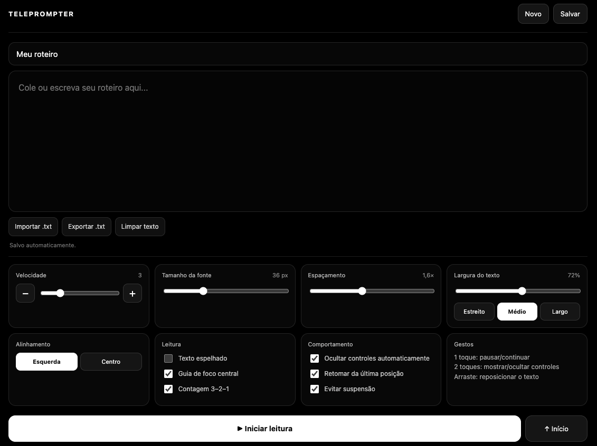
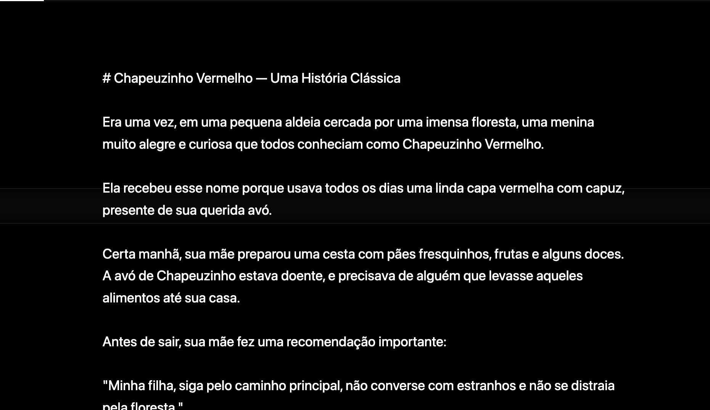

# Teleprompter Web

**Versão 2.1.0 · Open Source · Licença MIT**

Teleprompter gratuito e responsivo para ler roteiros durante gravações, apresentações e produção de conteúdo. Construído com **HTML, CSS e JavaScript puro**, sem necessidade de conta, instalação, framework ou servidor.

**[▶ Abrir Teleprompter online](https://lukasmonken.github.io/teleprompter-web/)** · [Código-fonte](https://github.com/lukasmonken/teleprompter-web) · [Histórico de versões](CHANGELOG.md)

> A interface desta versão está em português. O aplicativo funciona diretamente em navegadores modernos para desktop e celular.

## Capturas de tela

### Editor e configurações



### Modo de leitura



As imagens são capturas reais do aplicativo, fornecidas pelo autor. Os arquivos devem ser adicionados à pasta [`docs/screenshots`](docs/screenshots/README.md) com os nomes indicados para aparecerem automaticamente aqui.

## Funcionalidades

- **Rolagem automática:** 10 níveis de velocidade, ajustáveis antes e durante a leitura.
- **Modo espelhado:** indicado para uso com acessórios de teleprompter.
- **Texto configurável:** fonte, espaçamento, largura e alinhamento.
- **Contagem regressiva 3–2–1** antes de iniciar.
- **Leitura guiada:** guia de foco central, barra de progresso e controles flutuantes.
- **Gestos de toque:** um toque para pausar/continuar, dois toques para mostrar/ocultar controles, arraste para reposicionar.
- **Bloqueio de controles** para evitar mudanças acidentais.
- **Importação e exportação `.txt`** de roteiros.
- **Salvamento automático** de texto, preferências e posição de leitura no navegador.
- **Tela cheia e Screen Wake Lock**, quando suportados pelo navegador.

## Como usar

1. Abra a [versão online](https://lukasmonken.github.io/teleprompter-web/) ou o arquivo `index.html`.
2. Cole ou digite um roteiro — também é possível importar um arquivo `.txt`.
3. Ajuste velocidade, fonte, largura e outras preferências.
4. Clique em **Iniciar leitura**. Durante a leitura, pause, altere a velocidade ou arraste para reposicionar o texto.

### Atalhos de teclado

| Tecla | Ação |
| --- | --- |
| `Espaço` | Pausar / continuar |
| `↑` | Aumentar velocidade |
| `↓` | Diminuir velocidade |
| `Home` | Voltar ao início |
| `Esc` | Sair do modo de leitura (quando desbloqueado) |
| `L` | Bloquear / desbloquear controles |

## Executar localmente

Basta abrir `index.html` em um navegador moderno. Não há dependências para instalar.

```bash
git clone https://github.com/lukasmonken/teleprompter-web.git
cd teleprompter-web
```

Abra o arquivo `index.html`. O projeto também está hospedado no [GitHub Pages](https://lukasmonken.github.io/teleprompter-web/), a partir da branch `main`.

## Privacidade e compatibilidade

O projeto é uma aplicação estática e não utiliza conta ou backend. O roteiro e as preferências ficam no **`localStorage` do navegador**: eles não são sincronizados entre navegadores ou dispositivos. Limpar os dados do site pode apagar o conteúdo salvo; por isso, exporte cópias de segurança em `.txt`.

As APIs de tela cheia e de manter a tela ativa dependem das permissões e da compatibilidade de cada navegador.

## Roadmap — ideias para próximas versões

Os itens abaixo são **propostas**, ainda não funcionalidades implementadas:

- [ ] Gerenciar e alternar entre vários roteiros salvos.
- [ ] Instalação como Progressive Web App (PWA), com uso offline.
- [ ] Interface em inglês e seleção de idioma.
- [ ] Mais opções de acessibilidade e atalhos.
- [ ] Separar HTML, CSS e JavaScript em arquivos próprios, preservando a simplicidade do projeto.
- [ ] Testes automatizados e documentação de compatibilidade entre navegadores.

Sugestões podem ser discutidas nas [Issues](https://github.com/lukasmonken/teleprompter-web/issues).

## Contribuindo

Contribuições, correções e sugestões são bem-vindas. Leia [CONTRIBUTING.md](CONTRIBUTING.md) antes de abrir um pull request.

## Versões e licença

- [Changelog](CHANGELOG.md)
- [Notas preparadas para a versão v2.1.0](docs/release-notes/v2.1.0.md)
- [GitHub Releases](https://github.com/lukasmonken/teleprompter-web/releases)
- [Licença MIT](LICENSE)

© 2026 lukasmonken.

---

## English

**Teleprompter Web v2.1.0** is a free, responsive, open-source browser teleprompter built with vanilla HTML, CSS and JavaScript — no account, backend or dependencies required.

**[Launch the live app](https://lukasmonken.github.io/teleprompter-web/)** · [Source code](https://github.com/lukasmonken/teleprompter-web) · [Changelog](CHANGELOG.md)

### Features

Adjustable auto-scroll (10 speed levels), mirrored text, typography settings, countdown, focus guide, progress bar, floating controls, touch gestures, keyboard shortcuts, `.txt` import/export and browser-local autosave. Optional fullscreen and screen wake lock depend on browser support.

### Screenshots

Two desktop screenshots are documented above: the editor and the reading mode. See the [screenshot guide](docs/screenshots/README.md) for the exact filenames. Mobile screenshots can be added later.

### Get started

Open the [live demo](https://lukasmonken.github.io/teleprompter-web/) or `index.html`, paste or import your script, adjust the settings and click **Iniciar leitura** (Start reading). The current interface language is Portuguese.

### Privacy

Scripts and settings are saved locally in your browser using `localStorage`, not in the cloud. Export `.txt` backups if you want to preserve or transfer them.

### Roadmap and contributions

Potential future improvements include multiple script management, PWA/offline support, English localization, accessibility enhancements and automated testing. These are **ideas, not implemented features**. Contributions via [issues](https://github.com/lukasmonken/teleprompter-web/issues) and pull requests are welcome. See [CONTRIBUTING.md](CONTRIBUTING.md).

**License:** [MIT](LICENSE).